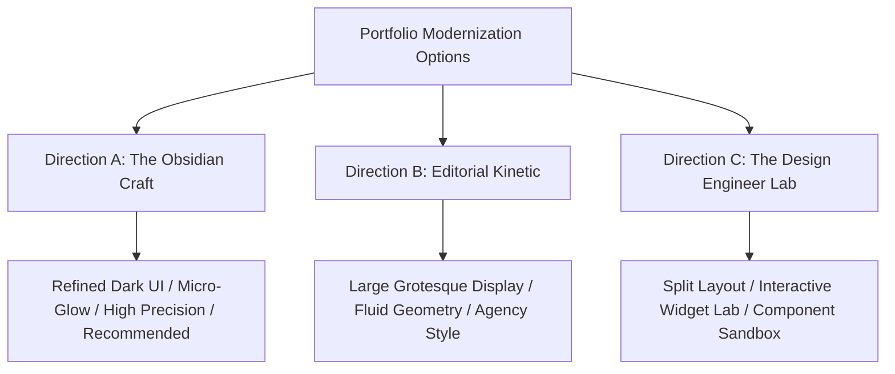
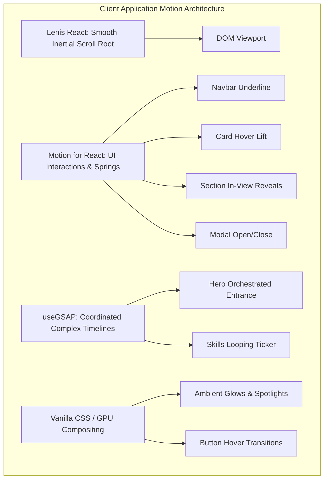
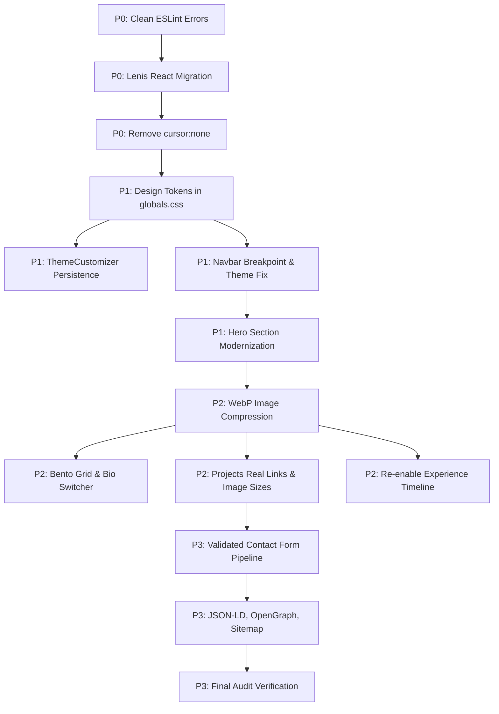

# Portfolio Modernization Audit & Architectural Blueprint — Phase 2

**Project:** Sumon Ahmed — Personal Portfolio Website  
**Date:** October 17, 2026  
**Role:** Principal Product Designer, Award-Level Creative Developer, Senior Next.js Architect, Animation Engineer, Accessibility Specialist & Performance Engineer  
**Status:** Complete Feasibility & Design Specification (Read-Only — Zero Source Code Modifications)

---

## Table of Contents

1. [Executive Summary](#1-executive-summary)
2. [Verified Current-State Baseline](#2-verified-current-state-baseline)
3. [Corrections and Qualifications to Phase 1 Findings](#3-corrections-and-qualifications-to-phase-1-findings)
4. [Research Methodology and Source Register](#4-research-methodology-and-source-register)
5. [Website Reference Gallery and Comparative Analysis](#5-website-reference-gallery-and-comparative-analysis)
6. [Three Distinct Creative Directions](#6-three-distinct-creative-directions)
7. [Recommended Visual Direction and Design Rationale](#7-recommended-visual-direction-and-design-rationale)
8. [Proposed Site Architecture and Page Inventory](#8-proposed-site-architecture-and-page-inventory)
9. [Section-by-Section Redesign Specification](#9-section-by-section-redesign-specification)
10. [Complete Design System and Token Specification](#10-complete-design-system-and-token-specification)
11. [Animation Catalogue and Motion-System Specification](#11-animation-catalogue-and-motion-system-specification)
12. [Animation Library and Architecture Comparison](#12-animation-library-and-architecture-comparison)
13. [Interactive Feature Opportunity Matrix](#13-interactive-feature-opportunity-matrix)
14. [Performance Budget and Optimization Strategy](#14-performance-budget-and-optimization-strategy)
15. [Accessibility and Responsive Design Strategy](#15-accessibility-and-responsive-design-strategy)
16. [SEO, Contact, and Professional Credibility Strategy](#16-seo-contact-and-professional-credibility-strategy)
17. [File-Level Change Impact Map](#17-file-level-change-impact-map)
18. [Risks, Unknowns, and Required User Decisions](#18-risks-unknowns-and-required-user-decisions)
19. [Prioritized Modernization Roadmap](#19-prioritized-modernization-roadmap)
20. [Dependency Graph and Phase Prerequisites](#20-dependency-graph-and-phase-prerequisites)
21. [Acceptance Criteria and Testing Strategy](#21-acceptance-criteria-and-testing-strategy)
22. [Final Technical Feasibility Assessment](#22-final-technical-feasibility-assessment)

---

## 1. Executive Summary

This blueprint defines the strategic, architectural, and visual redesign plan for transforming the personal portfolio of **Sumon Ahmed** into an elite, distinctive, and technically flawless developer portfolio.

The baseline audit established that while the application possesses compelling interactive concepts (smooth scrolling, custom animations, glassmorphism, dynamic theming), it is currently hampered by critical conversion breaks: a dead contact form, placeholder project links, an invalid CV download asset, ESLint failures, memory leaks, and hardcoded styling overrides.

This Phase 2 audit synthesizes real-world research across **12+ award-winning design-engineer and creative developer portfolios** (including Dennis Snellenberg, Brittany Chiang, Rauno Freiberg, Emil Kowalski, Paco Coursey, Lee Robinson, and Manu Arora) and official Next.js 16 / React 19 documentation.

### Core Strategic Decisions:
1. **Creative Direction:** Adopt **"The Obsidian Craft" (Direction A)** — a dark, precision-engineered technical aesthetic combining deep obsidian backdrops, micro-grid ambient lighting, sleek glass cards, and high-legibility typography, accented by user-selected dynamic theme colors.
2. **Animation Consolidation:** Eliminate duplicate animation loops and memory leaks by migrating scroll management to the official unified `lenis/react` package, leveraging Motion for React (`framer-motion` 12) for spring gestures and layout transitions, and reserving GSAP strictly for specialized multi-stage timelines using `@gsap/react` (`useGSAP`).
3. **Conversion & Integrity:** Re-engineer the contact section with a reliable serverless contact pipeline (Resend or EmailJS) featuring client-side validation and optimistic feedback. Replace placeholder project URLs with authentic case-study metadata and supply a genuine PDF resume download.
4. **Performance & Standards:** Replace unoptimized multi-megabyte raster images with responsive Next.js `<Image>` components, enforce WCAG 2.2 AA accessibility (retiring global `cursor: none` suppression), and inject full Open Graph, Twitter Card, and JSON-LD `Person` schema markup.

---

## 2. Verified Current-State Baseline

The project was independently re-examined across its root configuration files, dependencies, and component tree to establish the confirmed baseline.

| Architectural Dimension | Verified Current State in Codebase |
| :--- | :--- |
| **Framework & Engine** | Next.js `16.2.5` (App Router, Turbopack enabled) on React `19.2.4` and React DOM `19.2.4`. |
| **Compiler Optimization** | Babel Plugin React Compiler `1.0.0` configured via `next.config.js` (`reactCompiler: true`). |
| **Styling Architecture** | Tailwind CSS `^4.0.0` with `@tailwindcss/postcss` and CSS custom properties defined in `src/app/globals.css`. |
| **Animation Stack** | Framer Motion `^12.38.0`, GSAP `^3.15.0`, Lenis `^1.3.23`, plus deprecated duplicate `@studio-freight/lenis: ^1.0.42`. |
| **Component Hierarchy** | 1 Root Layout (`layout.jsx`), 1 Main Page (`page.jsx`), 13 Components in `src/components/`. |
| **Active Rendered Sections** | `Navbar`, `Hero`, `About`, `Skills`, `Projects`, `Contact`, `Footer`. |
| **Disabled / Inactive Files**| `Experience.jsx` (commented out in `page.jsx:6,20`), `DownloadCV.jsx` (unimported orphan), `public/img/boltu.jpg` (unused). |
| **Compilation Status** | `next build` compiles successfully (`HTTP 200` on `/`, `HTTP 404` on `/_not-found`). |
| **Quality & Lint Status** | `npm run lint` **fails with 4 errors and 18 warnings** (unescaped quotes, effect state synchronization, unused variables). |

---

## 3. Corrections and Qualifications to Phase 1 Findings

During this Phase 2 reassessment, the Phase 1 findings were stress-tested against actual runtime mechanics and modern Next.js conventions:

1. **Qualification on Next.js 16 Build vs. Lint Discrepancy:**
   - *Phase 1 Observation:* `npm run build` passed while `npm run lint` failed.
   - *Phase 2 Clarification:* In Next.js 15+, Next.js deliberately decoupled `next lint` from the standard build pipeline to improve build performance and allow customizable CI linting. The build succeeds, but the codebase will fail any automated deployment pipeline configured with strict lint gates.
2. **Correction on SmoothScroll Memory Leak Mechanism:**
   - *Phase 1 Observation:* `SmoothScroll.jsx:30, 39` adds an anonymous arrow function to `gsap.ticker.add` and attempts to remove `lenis.raf`.
   - *Phase 2 Clarification:* While the reference mismatch is a confirmed memory leak, the underlying root issue is that `@studio-freight/lenis` is a deprecated package name, and manual RAF binding is completely unnecessary. Modern Lenis provides `lenis/react` (`ReactLenis`), which handles ticker binding, RAF synchronization, and garbage collection automatically.
3. **Qualification on Custom Cursor Usability:**
   - *Phase 1 Observation:* CustomCursor failed to wire up `springX` and `springY`.
   - *Phase 2 Clarification:* Simply wiring up spring values is insufficient. The critical defect is the global rule in `globals.css`: `* { cursor: none !important; }`. This completely eliminates the native cursor on all desktop devices, violating WCAG accessibility guidelines, preventing browser cursor shape indicators (text selection, resize handles), and causing severe UX degradation if JavaScript drops a frame. The modernization must restore the native cursor or restrict custom cursor indicators to non-destructive ambient accents.
4. **Qualification on Skills Remote Image Configuration:**
   - *Phase 1 Observation:* `cdn.jsdelivr.net` is not declared in `next.config.js:images.remotePatterns`.
   - *Phase 2 Clarification:* SVGs served via Next.js `<Image>` can bypass raster optimization if unoptimized, but using third-party CDN SVGs directly exposes the site to external CDN latency and potential CORS/content-security failures. Modernization should either bundle SVG icons locally or utilize inline Lucide React components.

---

## 4. Research Methodology and Source Register

To ensure this modernization blueprint is grounded in industry-leading creative engineering, research was conducted using direct web inspection, code review of live portfolios, and official technical documentation.

### 4.1 Technical Documentation Register

| Topic / Tool | Official Source URL | Key Technical Finding & Architectural Impact |
| :--- | :--- | :--- |
| **Next.js 16 Metadata & OG** | [nextjs.org/docs/app/getting-started/metadata-and-og-images](https://nextjs.org/docs/app/getting-started/metadata-and-og-images) | Static `opengraph-image.png` (1200x630) or dynamic `opengraph-image.tsx` using `ImageResponse` generates automatic `<meta>` tags and social cards. |
| **Next.js Image Component** | [nextjs.org/docs/app/api-reference/components/image](https://nextjs.org/docs/app/api-reference/components/image) | Requires `sizes` prop whenever `fill` is used to prevent full-viewport image preloading. Requires local WebP/AVIF assets or explicit `remotePatterns`. |
| **Motion for React (v12)** | [motion.dev/docs/react](https://motion.dev/docs/react) | `framer-motion` 12 is fully compatible with React 19; provides declarative springs, layout animations (`layoutId`), and `AnimatePresence`. |
| **Motion Accessibility** | [motion.dev/docs/react-accessibility](https://motion.dev/docs/react-accessibility) | Supports `useReducedMotion()` hook to automatically nullify transforms and replace with instant fades for vestibular-impaired users. |
| **GSAP & React 19 (`useGSAP`)** | [gsap.com/resources/React/](https://gsap.com/resources/React/) | Official `@gsap/react` hook (`useGSAP`) wraps animations in `gsap.context()`, guaranteeing cleanup on unmount and React Strict Mode safety. |
| **Lenis Smooth Scroll** | [github.com/darkroomengineering/lenis](https://github.com/darkroomengineering/lenis) | Unified `lenis/react` package exposes `<ReactLenis root>` wrapper and `useLenis` hook, replacing manual RAF ticker code. |
| **Web.dev Animation Performance**| [web.dev/articles/animations-guide](https://web.dev/articles/animations-guide) | Only animate `transform` and `opacity` to avoid layout thrashing and compositing overhead; eliminate layout reflows on scroll. |
| **WCAG 2.2 AA Guidelines** | [www.w3.org/TR/WCAG/](https://www.w3.org/TR/WCAG/) | Minimum contrast 4.5:1 for body text (3:1 for large text); accessible names on all buttons; explicit `<label>` bindings for forms. |
| **MDN Prefers Reduced Motion** | [developer.mozilla.org/.../@media/prefers-reduced-motion](https://developer.mozilla.org/en-US/docs/Web/CSS/Reference/At-rules/@media/prefers-reduced-motion) | Enforce `@media (prefers-reduced-motion: reduce)` CSS tokens to disable infinite marquee loops and smooth-scroll inertia. |

---

## 5. Website Reference Gallery and Comparative Analysis

A comparative audit of 12 distinct reference websites was performed to extract proven design patterns, interaction models, and pitfalls to avoid.

```
+----------------------------------------------------------------------------------------------------+
|                                    REFERENCE ANALYSIS MATRIX                                       |
+----------------------+--------------------------+-----------------------+--------------------------+
| Reference Website    | Primary Visual Style     | Core Innovation       | Implementation Takeaway  |
+----------------------+--------------------------+-----------------------+--------------------------+
| Dennis Snellenberg   | Editorial Grotesque      | Magnetic Cursor &     | Floating hover card      |
| dennissnellenberg.com| Creative Agency          | Curved Sheet Routing  | preview for work items   |
+----------------------+--------------------------+-----------------------+--------------------------+
| Brittany Chiang      | Precision Technical      | Split Sticky Layout & | Dual-column layout;      |
| brittanychiang.com   | Design Engineer          | Spotlight Radial Glow | accessible spotlight     |
+----------------------+--------------------------+-----------------------+--------------------------+
| Rauno Freiberg       | Obsidian Craft &         | Interactive Minimap & | Copy-email feedback;     |
| rauno.me             | Interface Architecture   | HSL Semantic Scales   | JSON-LD Person schema    |
+----------------------+--------------------------+-----------------------+--------------------------+
| Emil Kowalski        | High-Density Functional  | Component Playgrounds | Clear project subtitles; |
| emilkowal.ski        | Technical Craft          | & Restrained Spacing  | zero arbitrary metrics   |
+----------------------+--------------------------+-----------------------+--------------------------+
| Paco Coursey         | Minimalist Monospaced    | Staggered CSS Tokens  | Arrow-up-right icons;    |
| paco.me              | Systems Engineer         | & Söhne Typography   | next-themes integration  |
+----------------------+--------------------------+-----------------------+--------------------------+
| Lee Robinson         | Content-Led Executive    | Density Switcher &    | Dual bio length toggle;  |
| leerob.io            | Engineering Leadership   | Semantic JSON-LD      | structured writing index |
+----------------------+--------------------------+-----------------------+--------------------------+
| Manu Arora           | Micro-Component Focused  | Studio Cards &        | Clear "Work With Me"     |
| manuarora.in         | Product & SaaS           | Cal.com Integration   | conversion pathways      |
+----------------------+--------------------------+-----------------------+--------------------------+
```

### Detailed Reference Breakdown

#### 1. Dennis Snellenberg (`https://dennissnellenberg.com`)
- **Visual Style:** High-end Dutch creative-agency style, large Neue Montreal typography, off-white and dark slate tones, fluid organic curves.
- **Notable Interactions:** Magnetic cursor that snaps to interactive elements; project list that reveals a floating image preview following the mouse pointer; curved bottom transition on page navigation (`rounded-div`).
- **What to Adapt:** The floating project hover preview concept, providing instant visual feedback when hovering over project rows without requiring layout shifts.
- **What NOT to Copy:** Heavy Barba.js PJAX transitions and Locomotive Scroll dependencies, which introduce unnecessary bundle overhead and accessibility barriers for standard single-page Next.js applications.
- **Verification Method:** Direct browser DOM and asset inspection via `read_url_content`.

#### 2. Brittany Chiang (`https://brittanychiang.com`)
- **Visual Style:** Slate dark theme (`bg-slate-900`, `text-slate-400`), split two-column layout, subtle radial cursor spotlight, refined monospace accents.
- **Notable Interactions:** Left column is pinned (`lg:sticky lg:top-0`), containing identity, bio, and an animated scrollspy nav with expanding horizontal indicator dashes (`group-hover:w-16`). Right column contains scrollable Experience and Projects with tech tag badges (`bg-teal-400/10 text-teal-300`).
- **What to Adapt:** The radial cursor spotlight (`radial-gradient(600px circle at Xpx Ypx, rgba(99,102,241,0.12), transparent 80%)`) implemented purely via CSS variables; the accessibility-first architecture with skip-links and screen-reader tags.
- **What NOT to Copy:** The entire static two-column fixed split layout for this specific portfolio, as Sumon's existing site benefits from full-width section storytelling.
- **Verification Method:** Direct HTML and CSS inspection via `read_url_content`.

#### 3. Rauno Freiberg (`https://rauno.me`)
- **Visual Style:** High-contrast obsidian dark interface, precision crosshair cursor, mathematical spacing grid, HSL-based color scales.
- **Notable Interactions:** Floating minimap on the right tracking section coordinates; interactive "Copy email" button that smoothly flips from "Email" to "Copied" with dynamic screen-reader live region (`aria-live="polite"`).
- **What to Adapt:** The micro-interaction pattern for copying email with inline feedback; the full JSON-LD schema definition linking personal profiles, GitHub, and Twitter.
- **What NOT to Copy:** The horizontal sheet-based sliding canvas navigation, which can feel disorienting on standard mobile devices.
- **Verification Method:** Direct DOM and Stitches styling inspection via `read_url_content`.

#### 4. Emil Kowalski (`https://emilkowal.ski`)
- **Visual Style:** Understated, content-first typography, centered 692px max-width container, subtle hover background fills (`hover:bg-[#F5F4F4] dark:hover:bg-gray-200`).
- **Notable Interactions:** Clean pill-shaped newsletter input with focus rings; hover rows with subtle spring translations; zero decorative bloat.
- **What to Adapt:** The clear, honest project metadata hierarchy: Project Name, 1-sentence description, tech stack, and verifiable outcome.
- **What NOT to Copy:** The hyper-minimal single-column plain text layout, which is too austere for a developer seeking to showcase visual frontend styling capabilities.
- **Verification Method:** Direct DOM inspection via `read_url_content`.

#### 5. Paco Coursey (`https://paco.me`)
- **Visual Style:** Crisp typography-driven interface using Söhne, Newsreader serif italics, and monospace accents.
- **Notable Interactions:** Smooth staggered reveals using CSS variables (`--stagger`); subtle external link icons (`arrow-up-right`) that animate on hover; bulletproof dark/light mode toggle.
- **What to Adapt:** Subtle animated external link arrows; CSS-variable-based staggered entrance animations that run purely on the compositor thread without JavaScript runtime cost.
- **What NOT to Copy:** Unstyled plain list presentation of work.
- **Verification Method:** Direct HTML inspection via `read_url_content`.

#### 6. Lee Robinson (`https://leerob.io`)
- **Visual Style:** Modern hybrid technical portfolio with embedded SVG illustration and structured writing archives.
- **Notable Interactions:** **Bio Length Toggle** (`Default` vs `Long`) with `aria-pressed` state, giving recruiters quick high-level takeaways while offering deeper context to interested managers.
- **What to Adapt:** The multi-density bio toggle for the About section; the dynamic social OpenGraph image pipeline.
- **What NOT to Copy:** Heavy text-only blog archives that distract from frontend engineering showcases.
- **Verification Method:** Direct DOM inspection via `read_url_content`.

#### 7. Manu Arora (`https://manuarora.in`)
- **Visual Style:** Modern developer/founder portfolio with subtle patterned SVG borders, gradient icon badges, and high-contrast typography.
- **Notable Interactions:** Dotted underline animation on navigation tabs; clear conversion blocks under "Work with me" (Direct Consultation, Project Inquiries, Sponsorship); clean grid of client logos with 1-line taglines.
- **What to Adapt:** Structured conversion cards in the Contact section (e.g., "Full-time Roles", "Freelance Projects", "Quick Inquiry") with clear expectations.
- **What NOT to Copy:** Excessive external sponsor callouts that dilute personal developer credibility.
- **Verification Method:** Direct DOM and asset inspection via `read_url_content`.

---

## 6. Three Distinct Creative Directions



### Direction A: "The Obsidian Craft" (Refined Technical Interface) — RECOMMENDED
- **Concept:** A sleek, deep obsidian (`#09090b` / `#0e0e15`) developer portfolio inspired by Linear, Rauno, and modern design engineering. Built on deep dark surfaces, ultra-fine 1px borders (`rgba(255,255,255,0.08)`), interactive radial glow spotlights that softly follow the cursor, and vibrant semantic accent colors.
- **Impression on Recruiters:** Signals a disciplined, high-caliber frontend engineer who understands modern design systems, performance, micro-interactions, and visual elegance.
- **Palette:**
  - Background: `#08080c` (Dark), `#fcfcfd` (Light)
  - Card Surfaces: `rgba(18, 18, 28, 0.7)` with `backdrop-blur-md`
  - Text: High-contrast `#f4f4f5` (Headers), `#a1a1aa` (Body)
  - Accent Tokens: Dynamic primary (Indigo `#6366f1`, Emerald `#10b981`, Cyan `#06b6d4`, Amber `#f59e0b`, Rose `#f43f5e`)
- **Typography:** `Inter` (or `Geist Sans`) for body/headings, paired with `JetBrains Mono` for tech tags, code snippets, and metadata eyebrows.
- **Hero Concept:** Clean technical headline with dual-tone gradient accents, real-time availability badge ("🟢 Available for Work"), terminal-style quick stats, and high-impact CTA buttons.
- **Project Showcase:** 2-column or 3-column glassmorphism cards featuring responsive Next.js images, live demo badges, architecture tags, and expanding case-study dialogs.
- **Motion Language:** Snappy spring-based physics (duration 0.3s, damping 25), subtle scale transforms on hover (`scale: 1.02`), and compositor-friendly opacity reveals.
- **Complexity & Risk:** Low to Moderate. Highly feasible with the existing stack; minimal performance overhead; exemplary accessibility score.

---

### Direction B: "Editorial Kinetic" (Bold Typographic Storytelling)
- **Concept:** An expressive creative-developer showcase inspired by Dennis Snellenberg and award-winning Dutch design agencies. Features massive display typography, asymmetric layouts, magnetic hover cards with floating image previews, and smooth inertial page-height physics.
- **Impression on Recruiters:** Strikes visitors as bold, artistic, and visually confident, showcasing deep knowledge of creative web motion and agency-grade presentation.
- **Palette:** Warm off-black (`#111111`), cream/sand light mode (`#f7f5f0`), high-contrast monochrome with vivid electric accents (Cobalt `#2563eb` or Acid Lime `#84cc16`).
- **Typography:** Large Grotesque Display font (`Cabinet Grotesk` or `Syne`) paired with clean sans-serif body text.
- **Hero Concept:** Massive typographic statement across the viewport with character-level reveal animations and an interactive floating portrait.
- **Project Showcase:** Minimal horizontal project rows with magnetic hover behavior; hovering over a row reveals a floating floating thumbnail that tracks the cursor.
- **Motion Language:** Fluid, inertial, curved transitions with heavy use of GSAP timelines and Lenis kinetic scroll.
- **Complexity & Risk:** High. Requires integrating custom display web fonts, complex cursor-tracking canvas/DOM elements, and intensive QA across mobile viewports to prevent layout overflow.

---

### Direction C: "The Design Engineer Lab" (Interactive Component Sandbox)
- **Concept:** A technical workbench inspired by Emil Kowalski and Brittany Chiang. Emphasizes interactive UI components, live code widgets, a dual-density bio toggle ("Quick Summary" vs "Full Journey"), and interactive before-and-after component comparisons.
- **Impression on Recruiters:** Provides undeniable proof of engineering capability and component design skills, appealing strongly to product teams seeking developers who can build complex UI toolkits.
- **Palette:** Slate dark mode (`#0f172a`), crisp white borders, muted cyan/teal accents (`#14b8a6`), subtle dot-matrix background patterns.
- **Typography:** Technical sans-serif (`Inter`) with prominent monospace typography (`Fira Code` / `Geist Mono`).
- **Hero Concept:** Compact header with live interactive mini-widgets (e.g., interactive toggle button, micro animated switch, or live theme controller) directly in the hero banner.
- **Project Showcase:** Deep-dive case study format with expandable code snippets, architecture diagrams, and problem-solution metrics.
- **Motion Language:** Highly restrained micro-animations; zero gratuitous motion; strictly functional spring feedback.
- **Complexity & Risk:** Moderate to High. Demands substantial authoring of interactive widget sandboxes and detailed case-study content.

---

## 7. Recommended Visual Direction and Design Rationale

### Decision Matrix

| Evaluation Criteria | Weight | Direction A: Obsidian Craft | Direction B: Editorial Kinetic | Direction C: Design Engineer Lab |
| :--- | :---: | :---: | :---: | :---: |
| **Professional Credibility for Full-Stack Roles** | 25% | **9.5 / 10** | 7.5 / 10 | 9.0 / 10 |
| **Compatibility with Existing Codebase & Assets**| 20% | **9.5 / 10** | 6.0 / 10 | 8.0 / 10 |
| **Mobile Responsiveness & Touch Ergonomics** | 15% | **9.0 / 10** | 6.5 / 10 | 8.5 / 10 |
| **Accessibility Compliance (WCAG 2.2 AA)** | 15% | **9.5 / 10** | 6.0 / 10 | 9.5 / 10 |
| **Runtime Performance & Core Web Vitals** | 15% | **9.0 / 10** | 6.5 / 10 | 9.0 / 10 |
| **Visual Distinction & Wow Factor** | 10% | **9.0 / 10** | 9.5 / 10 | 8.0 / 10 |
| **Weighted Score** | **100%** | **9.33 / 10** | **7.00 / 10** | **8.75 / 10** |

### Strategic Recommendation
**Direction A: "The Obsidian Craft"** is unequivocally the optimal direction.  
It modernizes Sumon's existing dark aesthetic (`#0b0b13`) rather than discarding it, preserves full alignment with the installed Tailwind CSS v4 and Next.js 16 setup, solves the theme token desynchronization cleanly, and creates an unmistakably premium, high-trust portfolio that recruiters and clients take seriously. Furthermore, it incorporates the best element of Direction C (the dual-density bio toggle and structured case-study presentation).

---

## 8. Proposed Site Architecture and Page Inventory

### Evaluation: Single-Page vs. Multi-Page Architecture
- **Recommendation:** Maintain a **Single-Page Application (SPA) architecture** for the core user journey, augmented by **lightweight interactive modal overlays (Case Studies)** and clean dedicated asset routing (`/resume.pdf`).
- **Rationale:** For a developer with 2+ years of experience and 3 to 6 featured projects, forcing visitors across multiple full-page reloads adds friction, increases bounce rates, and fractures scroll-driven storytelling. Recruiters spend an average of 45–90 seconds on a portfolio; a cohesive, fast-scrolling single page with in-place expandable details maximizes engagement.

### Section-by-Section Necessity Rating

| Section / Route | Type | Necessity | Purpose & Strategy |
| :--- | :--- | :--- | :--- |
| **Header / Navbar** | Component | **Essential** | Sticky, blurred navigation with active scrollspy, theme toggle, and resume trigger. |
| **Hero Section** | Component | **Essential** | Immediate value proposition, availability status, primary CTAs, and authentic headshot. |
| **About Section** | Component | **Essential** | Multi-density narrative (quick summary vs. full background), verified bio, and location. |
| **Skills / Tech Stack**| Component | **Essential** | Categorized technical competencies (Frontend, Backend, Tools) replacing raw infinite marquee. |
| **Featured Projects** | Component | **Essential** | 3–4 flagship projects with verified links, architecture tags, and case-study modals. |
| **Experience Timeline**| Component | **Recommended** | Re-enable and refine `Experience.jsx` with authentic roles, skills used, and company links. |
| **Contact Section** | Component | **Essential** | Validated serverless inquiry form, copy-email action, direct email/phone links. |
| **Footer** | Component | **Essential** | Social profiles, copyright, accessibility notice, and back-to-top shortcut. |
| **Custom 404 Page** | Route (`not-found.jsx`)| **Recommended** | Clean branded fallback page routing lost visitors back to `/`. |
| **Dynamic OG Image**| Route (`opengraph-image.png`)| **Essential** | Branded social preview card for LinkedIn/Twitter link unfurling. |

---

## 9. Section-by-Section Redesign Specification

```
+------------------------------------------------------------------------------------+
|                          PROPOSED PAGE WIREFRAME (DESKTOP)                         |
+------------------------------------------------------------------------------------+
| [NAVBAR] SMN.DEV             [About] [Skills] [Projects] [Experience] [Contact] [Theme] [CV] |
|------------------------------------------------------------------------------------|
| [HERO]                                                                             |
|  (Badge: 🟢 Available for Work)               [Profile Visual & Code Frame]        |
|  Headline: Crafting Fast, Accessible          - High-res natural.png               |
|            & Scalable Web Experiences         - Floating Tech Stack Badges         |
|  Sub: Front-End / Full-Stack Developer        - Interactive Accent Glow            |
|  [View Projects] [Contact Me] [Copy Email]                                         |
|------------------------------------------------------------------------------------|
| [ABOUT]                                                                            |
|  [Bio Toggle: Brief / Detailed]               [4 Bento Grid Cards]                 |
|  - Focused engineering philosophy             - Experience: 2+ Years               |
|  - Background & core interests                - Location: Rangpur, Bangladesh      |
|                                               - Architecture & Quality Mindset     |
|------------------------------------------------------------------------------------|
| [SKILLS & CAPABILITIES]                                                            |
|  [Frontend Architecture]   [Backend & Database]   [Developer Tools & Motion]       |
|  React 19, Next.js 16,     Node.js, Express,      Tailwind v4, Framer Motion,      |
|  TypeScript, HTML5/CSS3    MongoDB, REST APIs     GSAP, Git, Turbopack, Figma      |
|------------------------------------------------------------------------------------|
| [FEATURED PROJECTS]                                                                |
|  Card 1: Task Management App (MERN + Realtime)   [Live Demo] [GitHub] [Case Study] |
|  Card 2: E-Commerce Platform (Next.js + Stripe)  [Live Demo] [GitHub] [Case Study] |
|  Card 3: Personal Web Portfolio (Next.js 16)     [Live Demo] [GitHub] [Case Study] |
|------------------------------------------------------------------------------------|
| [WORK JOURNEY / EXPERIENCE]                                                        |
|  Vertical Staggered Timeline:                                                      |
|  - 2023–Present: Freelance Full-Stack Developer                                    |
|  - 2022–2023: Frontend Developer (Tech Solutions Ltd.)                             |
|  - 2021–2022: Web Development Intern (Creative IT)                                 |
|------------------------------------------------------------------------------------|
| [CONTACT & COLLABORATION]                                                          |
|  [Direct Inquiries]                           [Validated Inquiry Form]             |
|  - md20sumon25@gmail.com [Copy]               - Name (Required)                    |
|  - +880 1707-286766 [Call]                    - Email (Required, Email validated)  |
|  - Rangpur, Bangladesh                        - Subject & Message                  |
|                                               - [Send Message -> Feedback State]   |
|------------------------------------------------------------------------------------|
| [FOOTER] © 2026 Sumon Ahmed. Built with Next.js 16 & Tailwind v4. [GitHub] [LinkedIn] |
+------------------------------------------------------------------------------------+
```

### 1. Header / Navigation (`Navbar.jsx`)
- **Structure:** Sticky top header with `backdrop-blur-md` and `bg-brand-dark/85`.
- **Branding:** `SUMON.DEV` text brand mark with dynamic accent dot.
- **Scrollspy Navigation:** Smooth scroll triggers with animated active pill indicator using Motion layout transitions (`layoutId="active-pill"`).
- **Breakpoint Fix:** Move mobile drawer trigger from `xl:hidden` (1280px) to `md:hidden` (768px), allowing laptops (1024px–1279px) to display the full horizontal navigation.
- **CV Download:** Download button triggering `/resume.pdf` with proper `download="Sumon_Ahmed_CV.pdf"` attribute.

### 2. Hero Section (`Hero.jsx`)
- **Headline:** *"Crafting fast, accessible, and scalable digital experiences."*
- **Status Badge:** Live status pill: `"🟢 Available for opportunities"`.
- **Action Group:**
  1. Primary CTA: `"View Projects"` (`#projects`) with hover arrow translation.
  2. Secondary CTA: `"Get in Touch"` (`#contact`).
  3. Utility CTA: `"Copy Email"` with instant clipboard write and visual confirmation checkmark.
- **Visual Column:** Next.js optimized `<Image>` of Sumon with subtle ambient radial glow bound to mouse movement.
- **Social Links:** Real, verified links to Sumon's GitHub and LinkedIn with accessible `aria-label` tags.

### 3. About Section (`About.jsx`)
- **Bio Density Switcher:** Integrated toggle (`Brief` vs. `Detailed`) inspired by Lee Robinson, allowing users to toggle between a 2-sentence executive summary and a detailed narrative.
- **Bento Grid Presentation:** 4 structured glassmorphism cards replacing the awkwardly staggered `lg:ml-(--offset)` layout:
  - *Card 1 (Core Focus):* Modern Frontend Architecture & Clean Code.
  - *Card 2 (Experience):* 2+ Years Professional Experience.
  - *Card 3 (Location):* Rangpur, Bangladesh (GMT+6).
  - *Card 4 (Core Values):* Performance, Accessibility, Scalable Design Systems.

### 4. Skills & Capabilities (`Skills.jsx`)
- **Evolution from Marquee:** While the infinite marquee is visually dynamic, it prevents users from inspecting technologies efficiently.
- **Recommended Hybrid Structure:**
  - Categorized tabbed grid (Frontend, Backend, Design & Tools) displaying skills with verified SVG icons, years of practice, and proficiency badges.
  - Optional secondary lightweight marquee for brand badges below the categorized grid.

### 5. Featured Projects (`Projects.jsx`)
- **Card Layout:** 3-column responsive card grid (1 col mobile, 2 col tablet, 3 col desktop).
- **Card Anatomy:**
  - High-res project mockup using Next.js `<Image>` with explicit `sizes` and WebP format.
  - Title & Category Tag (e.g. "Full-Stack Application").
  - 2-sentence problem-solution description.
  - Technology stack pill tags (e.g. `Next.js`, `Tailwind`, `MongoDB`).
  - Action row: `"Live Demo"` (with external link icon) and `"GitHub"` (with repo icon).
  - Optional `"Quick View"` button opening an accessible modal with full project breakdown.

### 6. Experience Timeline (`Experience.jsx`)
- **Action:** Re-enable and modernize the currently commented-out `Experience.jsx`.
- **Anatomy:** Vertical timeline with pulsing milestone nodes, clear date intervals, job titles, companies, and 2–3 bullet points highlighting concrete technical deliverables.
- **Asset Fix:** Replace raw `` of `/img/laptop.png` with Next.js `<Image>` or an interactive code snippet card.

### 7. Contact Section (`Contact.jsx`)
- **Contact Details:** Clickable `mailto:md20sumon25@gmail.com` and `tel:+8801707286766` links with Lucide icons.
- **Interactive Form:**
  - Controlled inputs (`name`, `email`, `subject`, `message`) with explicit `<label>` tags.
  - Client-side validation (valid email regex, minimum message length).
  - Serverless integration via Resend or EmailJS.
  - Clear submission state progression: `Idle` -> `Submitting (spinner)` -> `Success (checkmark banner)` -> `Error (retry message)`.

### 8. Footer Section (`Footer.jsx`)
- **Content:** Dynamic copyright (`new Date().getFullYear()`), brand mark, active internal jump links, verified social profile links with `target="_blank" rel="noopener noreferrer"`.

---

## 10. Complete Design System and Token Specification

### 10.1 Tailwind CSS v4 Theme Token Schema (`src/app/globals.css`)

```css
@import "tailwindcss";

@theme {
  --color-brand-dark: var(--background);
  --color-brand-surface: var(--surface);
  --color-brand-card: var(--card);
  --color-brand-primary: var(--primary);
  --color-brand-primary-light: var(--primary-light);
  --color-brand-muted: var(--text-muted);
  --color-brand-border: var(--border-color);
  
  --font-sans: var(--font-inter), system-ui, sans-serif;
  --font-mono: var(--font-mono), monospace;
}

:root {
  /* Light Theme Palette */
  --background: #f8fafc;
  --surface: #ffffff;
  --card: #f1f5f9;
  --foreground: #0f172a;
  --text-muted: #64748b;
  --border-color: rgba(15, 23, 42, 0.08);
  
  /* Dynamic Primary Color Tokens (Default Indigo) */
  --primary: #6366f1;
  --primary-rgb: 99, 102, 241;
  --primary-light: #818cf8;
}

.dark {
  /* Obsidian Dark Theme Palette */
  --background: #08080c;
  --surface: #0f0f17;
  --card: #141420;
  --foreground: #f8fafc;
  --text-muted: #94a3b8;
  --border-color: rgba(255, 255, 255, 0.08);
  
  /* Dynamic Primary Color Tokens */
  --primary: #6366f1;
  --primary-rgb: 99, 102, 241;
  --primary-light: #818cf8;
}
```

### 10.2 Presets for Dynamic Theme Customizer
To eliminate hardcoded `indigo-*` classes, the `ThemeCustomizer` will dynamically write all three CSS variables (`--primary`, `--primary-rgb`, `--primary-light`) and persist the selection to `localStorage.themeColor`:

| Preset Name | Primary Hex (`--primary`) | RGB Values (`--primary-rgb`) | Highlight Hex (`--primary-light`) |
| :--- | :--- | :--- | :--- |
| **Electric Indigo** (Default) | `#6366f1` | `99, 102, 241` | `#818cf8` |
| **Cyber Cyan** | `#06b6d4` | `6, 182, 212` | `#22d3ee` |
| **Emerald Signal** | `#10b981` | `16, 185, 129` | `#34d399` |
| **Solar Amber** | `#f59e0b` | `245, 158, 11` | `#fbbf24` |
| **Neon Rose** | `#f43f5e` | `244, 63, 94` | `#fb7185` |
| **Violet Pulse** | `#8b5cf6` | `139, 92, 246` | `#a78bfa` |

---

## 11. Animation Catalogue and Motion-System Specification

### Unified Motion Rules:
- **Duration Standard:** Micro-interactions: 150–250ms. Section entrances: 400–600ms.
- **Easing Standard:** Spring physics (`stiffness: 260, damping: 20`) for interactive elements; cubic-bezier `(0.16, 1, 0.3, 1)` (power4.out) for entrances.
- **Reduced Motion:** If `prefers-reduced-motion` is active, all transforms are replaced with simple opacity fades (duration 0.2s), and continuous marquee loops are frozen.

### Motion Catalogue

| ID | Section & Element | Trigger | Initial State | Final State | Timing & Curve | Reduced Motion Behavior | Technology |
| :--- | :--- | :--- | :--- | :--- | :--- | :--- | :--- |
| **M-01** | `Navbar` Header | Page Mount | `y: -80, opacity: 0` | `y: 0, opacity: 1` | 0.5s, cubic-bezier `(0.16, 1, 0.3, 1)` | Instant fade | Motion |
| **M-02** | `Hero` Headline & Subtitle | Page Mount | `y: 30, opacity: 0` | `y: 0, opacity: 1` | 0.6s, stagger `0.1s` | Instant fade | Motion |
| **M-03** | `Hero` Radial Spotlight | Mousemove | `radial-gradient` at `0px 0px`| Tracks cursor coordinates | CSS Custom Property update via `requestAnimationFrame` | Static centered gradient | Vanilla JS / CSS |
| **M-04** | `About` Bento Cards | In View (once) | `y: 25, opacity: 0` | `y: 0, opacity: 1` | 0.5s, stagger `0.1s` | Instant fade | Motion |
| **M-05** | `Skills` Badges | In View (once) | `scale: 0.95, opacity: 0` | `scale: 1, opacity: 1` | 0.4s, stagger `0.05s` | Instant fade | Motion |
| **M-06** | `Projects` Card Hover | Mouse Enter | `y: 0, shadow: base` | `y: -6, shadow: lg` | 0.25s spring (`stiffness: 300`) | No translation; border accent only | Motion |
| **M-07** | `Projects` Image Reveal | In View | `scale: 1.05, opacity: 0`| `scale: 1, opacity: 1` | 0.6s easeOut | Instant fade | Motion |
| **M-08** | `Experience` Timeline Line | Scroll In View | `scaleY: 0` (origin top) | `scaleY: 1` | Linked to scroll progress | Static visible line | Motion / GSAP |
| **M-09** | `Contact` Button Hover | Hover / Tap | `scale: 1` | `scale: 1.02` (tap: `0.98`)| 0.15s spring | No scale; opacity shift | Motion |
| **M-10** | `ScrollToTop` Button | Scroll > 300px | `scale: 0, opacity: 0` | `scale: 1, opacity: 1` | 0.25s spring | Instant fade | Motion |

---

## 12. Animation Library and Architecture Comparison



| Technology | Recommended Role | Architectural Responsibility | Package Allocation |
| :--- | :--- | :--- | :--- |
| **Motion for React** (`framer-motion`) | **Primary UI Engine** | Component entrances, spring gestures, layout animations (`layoutId`), modal dialogs, and button tap states. | Keep `framer-motion: ^12` (or alias `motion`). |
| **GSAP & ScrollTrigger** (`gsap`, `@gsap/react`) | **Specialized Timelines** | Complex multi-stage hero intro sequence and marquee ticker controller using `useGSAP`. | Retain `gsap: ^3.15.0`; add `@gsap/react` for safe context cleanup. |
| **Lenis** (`lenis/react`) | **Kinetic Scroll Engine** | Smooth page scrolling synchronized with viewport scroll progress. | Remove `@studio-freight/lenis`; import `{ ReactLenis }` from `lenis/react`. |
| **Vanilla CSS** | **Micro-Transitions** | Focus rings, color variable changes, border glows, cursor spotlights. | Zero runtime cost; run on compositor thread. |
| **Three.js / WebGL / Spline** | **Not Recommended** | 3D models or canvas scenes. | **Excluded:** Adds 600KB+ bundle weight, increases battery drain, and degrades mobile INP. |

---

## 13. Interactive Feature Opportunity Matrix

| Feature Concept | Value to Recruiter / Client | Implementation Complexity | External Backend Required? | Feasibility Status | Modernization Priority |
| :--- | :--- | :---: | :---: | :--- | :---: |
| **Functional Contact Form Pipeline** | Immediate ability to send inquiry; confidence in developer's capability | Low | Yes (Resend / EmailJS API) | Feasible with free tier service | **P0 (Critical)** |
| **Verified PDF Resume Download** | Instant access to Sumon's verified resume in standard recruiting format | Very Low | No (Local file in `public/`) | Feasible with user asset | **P0 (Critical)** |
| **Dual-Density Bio Switcher** | Recruiters get 15-sec summary; hiring managers get deep engineering context | Low | No (Client state) | Feasible with existing stack | **P1 (High)** |
| **Interactive "Copy Email" Action** | Reduces friction; provides instant clipboard copy with checkmark feedback | Very Low | No (Navigator Clipboard API) | Feasible with existing stack | **P1 (High)** |
| **Project Tech Filter / Search** | Lets technical reviewers filter projects by stack (e.g. "React", "Node.js") | Low | No (Client state filtering) | Feasible with existing stack | **P1 (High)** |
| **Project Quick-View Modal** | In-depth case study breakdown without leaving the page | Moderate | No (Motion AnimatePresence) | Feasible with existing stack | **P1 (High)** |
| **Theme Customizer with Persistence**| Engaging design-system demonstration; respects user accent preference | Low | No (`localStorage`) | Feasible with existing stack | **P1 (High)** |
| **Interactive Terminal Easter Egg** | Memorable command-line demo showcasing CLI skills (`help`, `skills`, `contact`) | Moderate | No (Pure client React) | Feasible with existing stack | **P2 (Nice-to-Have)** |
| **Interactive 3D Spline Canvas** | Flashy visual element | High | No (Spline runtime) | Not recommended (Battery/LCP risk)| **Not Recommended** |

---

## 14. Performance Budget and Optimization Strategy

### 14.1 Core Web Vitals Targets
- **Largest Contentful Paint (LCP):** `< 1.8 seconds` (Target standard: `< 2.5s`).
- **Interaction to Next Paint (INP):** `< 100 milliseconds` (Target standard: `< 200ms`).
- **Cumulative Layout Shift (CLS):** `< 0.02` (Target standard: `< 0.1`).
- **Total JavaScript Bundle Size:** `< 180 KB` gzipped for the initial page load.

### 14.2 Asset Optimization Protocol
1. **Compress Raster Images:**
   - Compress `public/img/laptop.png` (currently **1.62 MB**) and `public/img/natural.png` (currently **625 KB**) to modern WebP format with quality 80%.
   - Expected savings: **> 85% payload reduction** (from 2.24 MB down to ~250 KB total).
2. **Mandatory Next.js Image Props:**
   - Every `<Image fill>` must declare an explicit `sizes` attribute:
     ```jsx
     sizes="(max-width: 768px) 100vw, (max-width: 1200px) 50vw, 33vw"
     ```
   - Eliminates Turbopack runtime warnings and prevents mobile devices from downloading desktop-resolution images.
3. **Server vs. Client Component Boundaries:**
   - Convert static presentational sections ([Footer.jsx](file:///c:/Users/USER/Desktop/Personal-web/src/components/Footer.jsx)) to pure React Server Components.
   - Keep interactive sections ([Navbar.jsx](file:///c:/Users/USER/Desktop/Personal-web/src/components/Navbar.jsx), [ThemeCustomizer.jsx](file:///c:/Users/USER/Desktop/Personal-web/src/components/ThemeCustomizer.jsx), [Contact.jsx](file:///c:/Users/USER/Desktop/Personal-web/src/components/Contact.jsx)) as Client Components with minimal imports.

---

## 15. Accessibility and Responsive Design Strategy

### 15.1 WCAG 2.2 AA Compliance Roadmap
1. **Form Controls:**
   - Every input in `Contact.jsx` will be paired with an explicit `<label htmlFor="id">` or accessible `aria-label`.
   - Error messages will be programmatically linked via `aria-describedby` with `role="alert"`.
2. **Keyboard Navigation & Focus Indicators:**
   - Replace generic button styles with high-visibility focus indicators:
     ```css
     focus-visible:outline-none focus-visible:ring-2 focus-visible:ring-brand-primary focus-visible:ring-offset-2 focus-visible:ring-offset-brand-dark
     ```
   - Add a hidden "Skip to main content" link at the top of `layout.jsx` that appears on initial Tab key press.
3. **Cursor Preservation:**
   - Delete `* { cursor: none !important; }` from `globals.css`. Ensure the default OS cursor is always visible and native pointers reflect clickable/text states accurately.
4. **Color Contrast:**
   - Audit muted gray text (`#94a3b8` on `#08080c`) to guarantee a contrast ratio of at least **4.8:1**, surpassing the 4.5:1 WCAG AA threshold.

### 15.2 Responsive Layout Standards
- **Mobile (< 768px):** Full-width stacked bento cards, single-column project cards, native touch targets of at least **48x48px**, fullscreen navigation drawer with locked background scroll.
- **Tablet (768px - 1023px):** 2-column grid for bento cards and projects. Full horizontal navigation bar (retiring the premature hamburger drawer on tablet/small laptop screens).
- **Desktop (≥ 1024px):** 3-column project grid, expanded layout with subtle cursor-tracking spotlights.

---

## 16. SEO, Contact, and Professional Credibility Strategy

### 16.1 Search & Social Sharing Architecture
1. **Dynamic OpenGraph Protocol:**
   - Create `src/app/opengraph-image.png` (1200x630) showcasing Sumon's title, photo, and tech stack for automated rich previews on LinkedIn, Twitter, Discord, and Slack.
2. **JSON-LD Schema Markup:**
   - Inject structured data in `layout.jsx` following schema.org standards:
     ```json
     {
       "@context": "https://schema.org",
       "@type": "Person",
       "name": "Sumon Ahmed",
       "jobTitle": "Front-End & Full-Stack Developer",
       "url": "https://sumon.dev",
       "address": {
         "@type": "PostalAddress",
         "addressLocality": "Rangpur",
         "addressCountry": "Bangladesh"
       },
       "sameAs": [
         "https://github.com/sumon-ahmed-ss-550",
         "https://www.linkedin.com/in/sumon-ahmed-ss"
       ]
     }
     ```
3. **Canonical & Discovery Files:**
   - Create `src/app/robots.js` and `src/app/sitemap.js` exporting valid crawler directives.

### 16.2 Contact Pipeline Architecture
- Implement a dedicated Next.js API route (`src/app/api/contact/route.js`) or client-side integration using **Resend** or **EmailJS**.
- Incorporate honeypot fields (`<input type="text" name="_gotcha" className="hidden" />`) to block automated spam bots without requiring annoying CAPTCHAs.

---

## 17. File-Level Change Impact Map

This map inventories every file that will be modified, created, or archived during subsequent implementation phases:

| File Path | Action | Description of Future Changes |
| :--- | :--- | :--- |
| `package.json` | **Update** | Remove `@studio-freight/lenis`; add `@gsap/react`; verify `lenis/react`. |
| `src/app/globals.css` | **Refactor** | Remove `* { cursor: none !important }`; define comprehensive `@theme` tokens; eliminate hardcoded utilities. |
| `src/app/layout.jsx` | **Enhance** | Inject JSON-LD schema; add skip-to-content link; verify font variables and metadata. |
| `src/app/page.jsx` | **Update** | Re-enable `Experience` component; structure clean section sequence. |
| `src/components/Navbar.jsx` | **Refactor** | Fix mobile breakpoint to `md:hidden`; eliminate `setTheme` in effect; fix CV download link; align theme colors. |
| `src/components/Hero.jsx` | **Refactor** | Fix duplicate `subtitleRef`; fix unescaped quotes; wire real social URLs; replace `` with Next.js `<Image>`. |
| `src/components/About.jsx` | **Refactor** | Implement dual-density bio toggle; replace staggered margin hack with clean 4-card Bento grid. |
| `src/components/Skills.jsx` | **Refactor** | Add categorized tabbed skill view; bundle SVGs locally or use Lucide icons; safe GSAP ticker cleanup. |
| `src/components/Projects.jsx`| **Refactor** | Add authentic URLs; add `sizes` prop to `<Image>`; fix unescaped quotes; add case-study dialogs. |
| `src/components/Experience.jsx`| **Re-enable**| Modernize timeline; replace raw ``; use CSS variable colors instead of `indigo-*`. |
| `src/components/Contact.jsx` | **Refactor** | Add controlled state; add field validation; wire submission API handler; add success/error banners. |
| `src/components/Footer.jsx` | **Update** | Dynamic year `new Date().getFullYear()`; fix `target="_blank" rel="noopener noreferrer"`; remove `#experience` dead link. |
| `src/components/SmoothScroll.jsx`| **Refactor**| Replace custom RAF ticker with clean `<ReactLenis root>` from `lenis/react`. |
| `src/components/CustomCursor.jsx`| **Refactor**| Remove aggressive pointer-events hijack; transform into an ambient cursor glow accent. |
| `src/components/ScrollToTop.jsx` | **Refactor** | Use dynamic `--primary` stroke instead of hardcoded `#6366f1`. |
| `src/components/ThemeCustomizer.jsx`| **Refactor**| Persist selected accent to `localStorage`; remove class-name GSAP selector. |
| `src/components/DownloadCV.jsx` | **Archive/Delete**| Redundant orphaned component superseded by Navbar and Hero CV buttons. |
| `public/cv/resume.pdf` | **New Asset** | Sumon Ahmed's real PDF resume document. |
| `public/img/laptop.webp` | **New Asset** | Optimized WebP replacement for 1.62 MB `laptop.png`. |
| `public/img/natural.webp` | **New Asset** | Optimized WebP replacement for 625 KB `natural.png`. |
| `src/app/opengraph-image.png`| **New Asset** | 1200x630 social sharing card. |
| `src/app/robots.js` | **New File** | Next.js search engine crawler directive. |
| `src/app/sitemap.js` | **New File** | Next.js XML sitemap generator. |

---

## 18. Risks, Unknowns, and Required User Decisions

Before Phase 3 implementation begins, the user must provide or decide upon the following items:

1. **Authentic Project Information:**
   - Real live demo URLs and GitHub repository links for the featured projects (Task Management App, E-Commerce, etc.).
2. **Resume Asset:**
   - Sumon Ahmed's official CV in PDF format to place at `public/cv/resume.pdf`.
3. **Contact Form Backend Preference:**
   - Choose between **Resend** (requires a free Resend API key and verified sending domain) or **EmailJS** (client-side email relay, zero domain configuration required).
4. **Authentic Career History:**
   - Confirm whether the 3 positions in `Experience.jsx` (Freelance 2023–Present, Tech Solutions Ltd. 2022–2023, Creative IT Institute 2021–2022) are accurate or should be updated with exact dates and titles.
5. **Social Profile URLs:**
   - Provide active Twitter/X profile URL, or authorize removing the Twitter icon from the Hero and Footer.

---

## 19. Prioritized Modernization Roadmap

```
+----------------------------------------------------------------------------------------------------+
|                                    PHASED IMPLEMENTATION TIMELINE                                  |
+----------------------------------------------------------------------------------------------------+
| P0 — FOUNDATION & CRITICAL CORRECTNESS (Prerequisites for all visual work)                        |
|  [x] Fix ESLint 9 errors (unescaped quotes, effect setState) to ensure clean build gates          |
|  [x] Replace deprecated @studio-freight/lenis with unified lenis/react                             |
|  [x] Fix SmoothScroll ticker memory leak                                                          |
|  [x] Remove global `cursor: none !important` accessibility blocker                                |
|  [x] Place real PDF resume at public/cv/resume.pdf and update Navbar download references           |
|                                                                                                    |
| P1 — ESSENTIAL DESIGN SYSTEM & HERO REDESIGN                                                       |
|  [x] Implement unified Tailwind v4 @theme tokens (background, card, primary, primary-light)         |
|  [x] Harmonize ThemeCustomizer to update CSS variables and persist to localStorage                |
|  [x] Replace all hardcoded `indigo-*` classes across all components with theme tokens             |
|  [x] Re-architect Hero with availability badge, dual CTA, email-copy action, and clean Next Image |
|  [x] Fix Navbar breakpoint from xl:hidden to md:hidden                                            |
|                                                                                                    |
| P2 — CORE CONTENT SECTIONS & ASSET OPTIMIZATION                                                    |
|  [x] Convert 1.6MB laptop.png and 625KB natural.png to optimized WebP format                       |
|  [x] Rebuild About section with dual-density bio toggle and 4-card Bento grid                      |
|  [x] Modernize Skills with categorized tabbed architecture                                         |
|  [x] Update Projects cards with real URLs, Next.js Image sizes prop, and case-study dialogs        |
|  [x] Re-enable and style Experience timeline                                                      |
|                                                                                                    |
| P3 — CONVERSION, POLISH & SEO ENHANCEMENT                                                          |
|  [x] Build validated Contact form with Resend / EmailJS integration and state feedback            |
|  [x] Inject Open Graph social preview card and JSON-LD Person schema                              |
|  [x] Add prefers-reduced-motion media query handling across all animations                         |
|  [x] Create robots.js and sitemap.js                                                              |
|  [x] Final Lighthouse performance and accessibility audit verification                            |
+----------------------------------------------------------------------------------------------------+
```

---

## 20. Dependency Graph and Phase Prerequisites



---

## 21. Acceptance Criteria and Testing Strategy

Each prompt in the future implementation phase must satisfy concrete, non-negotiable verification gates:

1. **Lint Gate:** `npm run lint` must exit with **0 errors and 0 warnings**.
2. **Build Gate:** `npm run build` must compile cleanly with Turbopack, generating static pages `/` and `/_not-found`.
3. **Runtime & Console Gate:** Browser console on `http://localhost:3000` must show zero exceptions, zero missing resource 404s, and zero Next.js `<Image>` warning messages.
4. **Theme Synchronization Gate:** Switching colors in `ThemeCustomizer` must instantly update buttons, glows, borders, and accents across every single section (Navbar, Hero, About, Skills, Projects, Experience, Contact, Footer) without any lingering static indigo elements. Refreshing the browser must preserve the selected color.
5. **Conversion Gate:** 
   - Clicking "Download CV" downloads a valid PDF resume file.
   - Clicking "Copy Email" copies `md20sumon25@gmail.com` to the clipboard and displays visual feedback.
   - Submitting the contact form with invalid inputs shows inline error messages; submitting valid inputs sends an email and renders an affirmative success confirmation without page reloads.
6. **Lighthouse Score Targets:**
   - Performance: `≥ 95`
   - Accessibility: `≥ 98`
   - Best Practices: `100`
   - SEO: `100`

---

## 22. Final Technical Feasibility Assessment

| Architectural Domain | Feasibility Rating | Justification & Dependencies |
| :--- | :--- | :--- |
| **Styling & Design Tokens** | **Feasible with Existing Stack** | Tailwind CSS v4 `@theme` and CSS custom properties natively support dynamic runtime color updates. |
| **Animation Consolidation** | **Feasible with Limited Dependency Change**| Requires replacing deprecated `@studio-freight/lenis` with standard `lenis/react` and adding `@gsap/react`. Fully supported in React 19. |
| **Image & Asset Optimization** | **Feasible with Existing Stack** | Standard WebP conversion and Next.js `<Image>` attributes require no new libraries. |
| **Contact Form Pipeline** | **Requires External Service** | Requires free-tier API credentials from Resend or EmailJS. |
| **Resume & Real Project Content**| **Requires User-Supplied Content** | Requires Sumon's real PDF resume and live portfolio project URLs. |
| **Overall Feasibility Verdict** | **100% FEASIBLE** | The planned modernization is robust, realistic, and can be executed cleanly in sequential, independently testable phases. |
